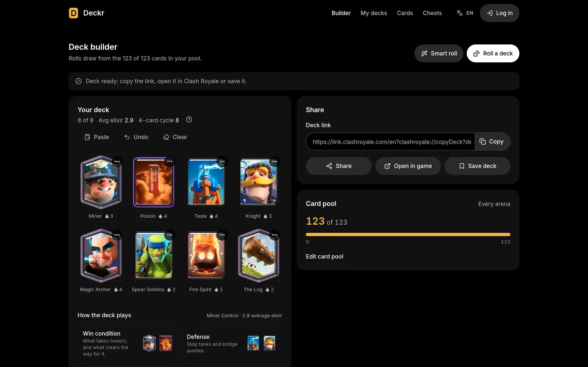
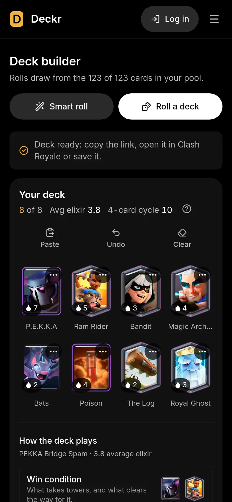
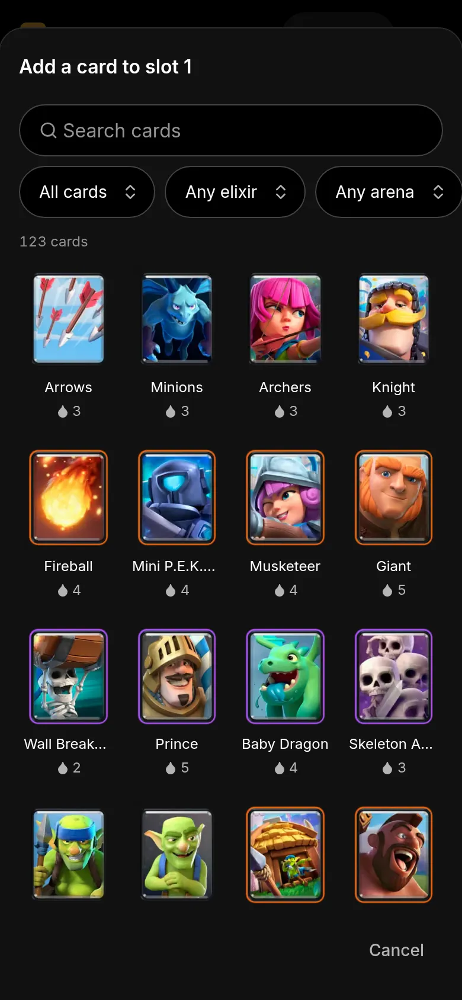
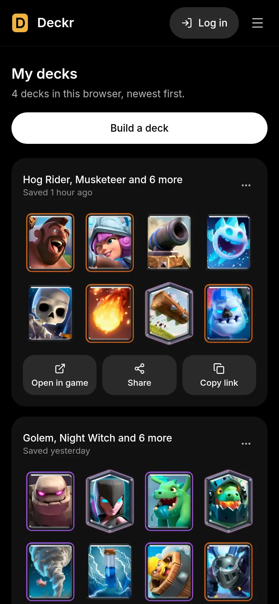
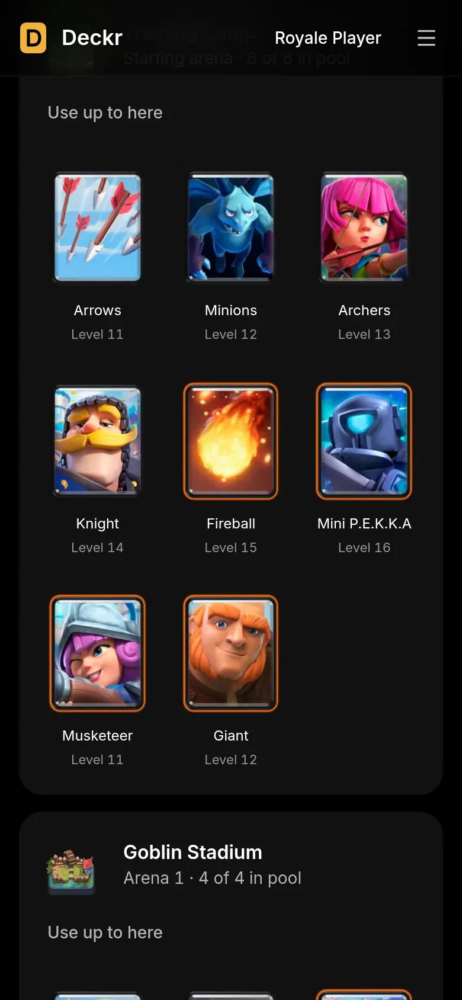
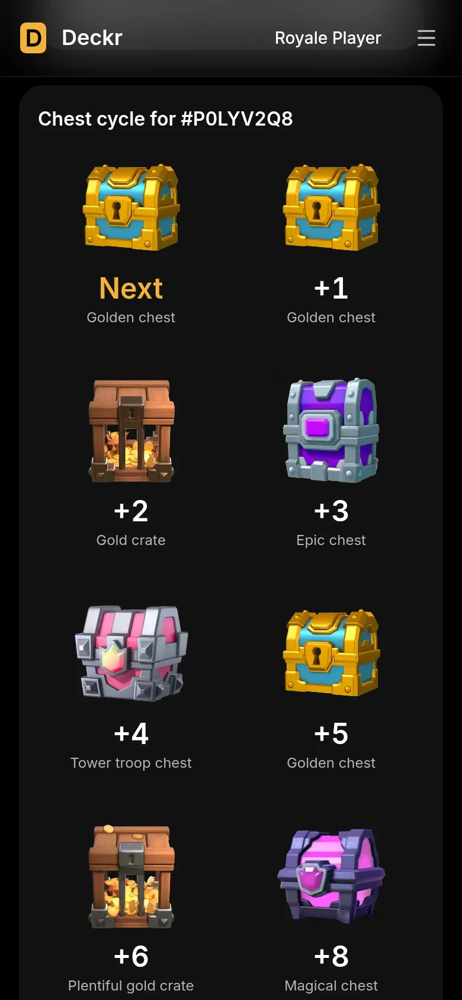
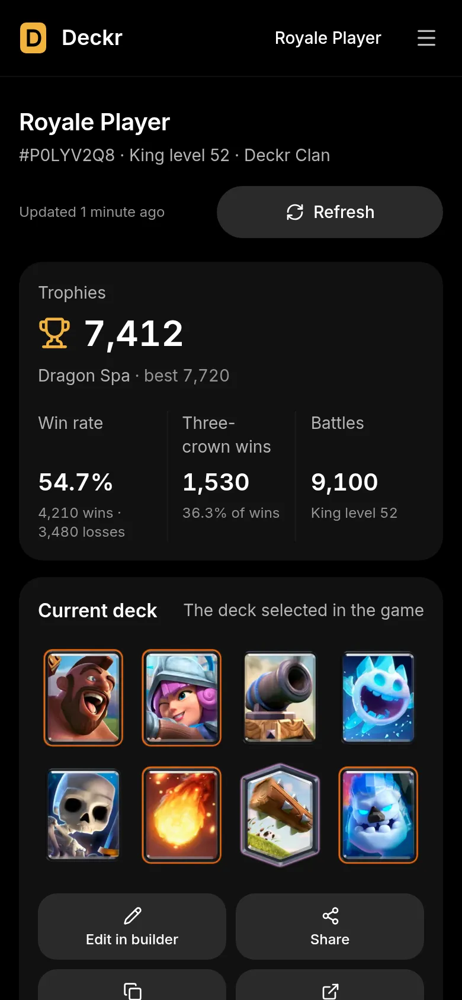

# Deckr

Deck builder and manager for Clash Royale.

Roll 8-card decks from the cards you have unlocked, paste deck links shared from the game, copy or open a deck in Clash Royale, keep the ones you like, and look up a player's upcoming chests.

Made by [Lucas Bittencourt](https://lucasbittencourt.dev/).

## Stack

| Part              | Tech                                                                |
| ----------------- | ------------------------------------------------------------------- |
| `apps/web`        | Next.js 16 (App Router), React 19, Tailwind CSS 4, Base UI, lucide  |
| `apps/api`        | Node.js 24 (runs TypeScript natively), Express 5, Mongoose 9, Zod 4 |
| `packages/shared` | Card catalog, deck-link rules and API schemas used by both apps     |
| Tooling           | pnpm workspaces, TypeScript 7, Biome                                |
| Database          | MongoDB 9                                                           |

## Run everything with Docker

```bash
cp .env.example .env   # optional: set WEB_PORT or ROYALEAPI_TOKEN
docker compose up -d --build
```

Open <http://localhost:8080>. Compose starts MongoDB, the API and the Next.js server, which also forwards `/api` to the API.

## Deploy (Railway)

Live at **https://deckr.lucasbittencourt.dev**. `infra/railway.ts` defines the Railway project **deckr**: `web` (public), `api` and MongoDB on the private network, each service rebuilt only when its files change. Commands, resource ceilings and the variables that connect the services: [infra/README.md](infra/README.md).

## Develop locally

Requires Node.js 24+ and pnpm 12 (`corepack enable` or `npm i -g pnpm`).

```bash
pnpm install
pnpm db          # starts only MongoDB in Docker (localhost:27017)
pnpm dev         # web on http://localhost:3000, API on http://localhost:3001
```

The API reads `apps/api/.env` (see `apps/api/.env.example`).

Or run the whole Docker stack in development mode, with the API and web app reloading from the source on every save at http://localhost:8080 (same database and `.env`):

```bash
docker compose -f compose.yaml -f compose.dev.yaml up -d   # dev mode, hot reload
docker compose up -d --build                               # back to the production build
```

Hot reload only exists in `pnpm dev` and in dev mode; the plain Docker stack is a production build. Next blocks hot reload for hosts other than `localhost` unless they're allowed; `next.config.ts` allows `127.0.0.1` and this machine's own addresses (WSL's IP from Windows included). Add others with `DEV_ORIGINS=host1,host2`.

## Smart roll

**Smart roll** (next to **Roll a deck**) builds a deck around a meta archetype (Hog Cycle, Log Bait, Golem, LavaLoon, X-Bow…) defined in `apps/web/src/lib/smart-deck.ts`. Each archetype is a set of groups with one job (win condition, bait, support, defense, air control, spells, cycle), each slot with alternative cards, plus an average-elixir range. A roll picks an archetype and a card per slot from the player's pool, around locked cards, and retries until the elixir fits; no AI or network. The groups show under the hand, one square each; hovering a square points its cards out in the hand.

## Design system

Shared UI lives in `apps/web/src/components/ui`, built on [Base UI](https://base-ui.com) primitives (button, dialog, alert dialog, select, menu, field, input, meter, toggle, toast) and styled with the Tailwind tokens in `src/app/globals.css`. Screens import from `@/components/ui` only.

## Clash Royale account

**Log in** (top right) connects a player through the official [Clash Royale API](https://developer.clashroyale.com), in one of two ways:

| Method            | What the player enters                                 | How Deckr reads their data                                                                                                                                       | What they can see                       |
| ----------------- | ------------------------------------------------------ | ---------------------------------------------------------------------------------------------------------------------------------------------------------------- | --------------------------------------- |
| **In-game token** | Tag + the token from the game's _Settings → API Token_ | The token is checked once with `POST /players/{tag}/verifytoken`, then Deckr reads the player with its own key (`CLASH_ROYALE_API_KEY`). The token isn't stored. | Their own data only                     |
| **Your API key**  | Tag + their own key from developer.clashroyale.com     | Their key, stored **encrypted** (AES-256-GCM)                                                                                                                    | Any player (e.g. other players' chests) |

- The in-game token login needs `CLASH_ROYALE_API_KEY`: a developer key Deckr owns, allowed for the server's public IP, **and** with permission to call `verifytoken`. Regular developer keys don't have it (Clash Royale answers `accessDenied.invalidScope`; it's granted to partner sites). Deckr checks this once an hour and, without it, offers only "Your API key".
- API keys only work from the IP addresses allowed on them, so the help shows the address Deckr's server calls from (`GET /api/server`).
- The encryption key comes from `TOKEN_SECRET`, or is generated once into `DATA_DIR` (the `api-data` volume in Docker).
- Sessions are an `HttpOnly` cookie; only a hash of it is stored, and it expires after 90 days.

Once connected, Deckr shows the player's profile, current deck, collection with card levels and recent battles (`/profile`), can build the card pool from the collection, load the in-game deck into the builder, and looks up upcoming chests.

- Player data is fetched from Clash Royale when the player logs in, when they press **Refresh** (account menu or profile, `POST /api/me/sync`), and when they come back with a session still open and the stored data is more than 30 minutes old. Nothing runs on a schedule.

## Saved decks

- **Logged out:** decks are saved in the browser (`localStorage`).
- **Logged in:** decks are saved to the player's account and mirrored in the browser, so they're still there after logging out.
- **Logging in** (or coming back logged in) syncs once through `POST /api/decks/sync`: decks saved while logged out are added to the account, decks removed while logged out are removed from it, and the browser's copy becomes the account's list. Each deck has an id created in the browser, so syncing never duplicates it.
- Decks mirrored from one account are never uploaded to another account that logs in on the same browser.

## Languages and SEO

- **Portuguese** is the default, at the root URLs (`/`, `/cards`); **English** lives under `/en` (`/en`, `/en/cards`).
- All copy is in `apps/web/src/i18n/dictionaries`: `pt-br.ts` is the source and defines the `Dictionary` type, so `en.ts` must have every key. Client components read it with `useI18n()` (`t`, `locale`, `href()` for localized links).
- Every language renders from `app/[locale]`. `src/proxy.ts` rewrites root URLs to `/pt-br/…` internally, redirects `/pt-br/…` to the root URL, and serves unknown addresses as that language's 404.
- The API answers errors with a `code` (`packages/shared/src/schemas.ts`); the web app words it in the reader's language.
- Pages are registered in `apps/web/src/lib/site.ts` (path, indexable). `lib/seo.ts` builds titles, descriptions, canonical URLs, `hreflang` alternates (`pt-BR`, `en`, `x-default`) and Open Graph locales from it; `sitemap.xml` and `robots.txt` use the same list. My decks and Profile are `noindex`.
- Set `SITE_URL` (build argument in Docker) to the public address. Without it, canonical URLs point at localhost and robots.txt blocks crawling.
- Card, arena, chest and battle-mode names come from the game data in English and aren't translated yet.
- The home page has Schema.org JSON-LD (`WebSite`, `WebApplication`, author) built from facts on the page (`lib/structured-data.ts`), a visible FAQ, and each language has its own share image (`app/[locale]/opengraph-image.tsx`). `/llms.txt` lists the public pages in both languages.
- The footer carries the notice Supercell's Fan Content Policy asks for.

## Installable app (PWA)

Deckr installs as an app on phones, tablets and desktops (mostly used on phones).

- **Manifest** per language (`/manifest.webmanifest`, `/manifest.en.webmanifest`, built in `apps/web/src/lib/pwa.ts`), one app (`id: "/"`): PNG and maskable icons at 192 and 512 px (`pnpm --filter @deckr/web icons` regenerates them from the mark), screenshots for the richer install sheet (narrow and wide, in `public/screenshots`), shortcuts to each screen.
- **Service worker** (`/sw.js`, generated by `apps/web/src/app/sw.js/route.ts`): card, arena and chest art is cached for good and only replaced when the art changes (the cache is named after a hash of every image, so new art means a new worker that drops the old cache); Next's hashed JS and CSS are cached too; pages are network first and fall back to the saved copy, so the app opens offline. The API is never cached. In `next dev` it caches images only.
- **Install button**: Chrome, Edge and Android use their own prompt; on iPhone and iPad it explains Share → Add to Home Screen.
- **Play Store**: package the PWA as a Trusted Web Activity with [Bubblewrap](https://github.com/GoogleChromeLabs/bubblewrap) (`bubblewrap init --manifest https://deckr.lucasbittencourt.dev/manifest.webmanifest`) or [PWABuilder](https://www.pwabuilder.com/). Then set `ANDROID_PACKAGE_NAME` and `ANDROID_CERT_FINGERPRINTS` (the signing key's SHA-256, from Play App Signing) on the web service: `/.well-known/assetlinks.json` lists them, which lets the Android app open Deckr full screen without the browser bar.

## When the server's IP changes

Players' Clash Royale API keys only work from the IP addresses they allow, and Railway's Hobby plan has no fixed outbound IP. When Clash Royale rejects a key (`cr_key_rejected`), the API looks up its current IP again and returns it with the error; the web app then shows a banner under the header with the fix: the new address to copy, the steps on developer.clashroyale.com and a field for the new key, which keeps the account and its decks. A failed login shows the same address and link in the login dialog.

## Loading without flicker

Pages are prerendered, so the HTML is what a first-time visitor sees: every card in the pool, an empty deck, nobody signed in. Data kept in the browser (pool, draft deck, saved decks) and the session only arrive after JavaScript runs. An inline script in `<head>` (`lib/prepaint.ts`) marks `<html>` with what this browser has stored before the first paint, and `<Prepaint>` shows, for each value, the server's version when nothing is stored (it's already right, and paints immediately) or a skeleton until the real value is in. Values never change after they're shown.

## Tests

`pnpm test` runs the URL rules (`src/i18n/config.test.ts`) and the proxy's rewrites, redirects and 404s (`src/proxy.test.ts`) with Node's test runner.

## Card data and art

The catalog (`packages/shared/src/catalog.json`) lists every deck card with its official id (used in deck links) and the Trophy Road arena that unlocks it. Indexes are stable: new cards are appended, because saved decks and stored card pools refer to cards by index. Bump `version` when the list changes.

Art lives in `apps/web/public/{cards,arenas,chests}` as WebP. To add or refresh art, drop PNGs named by slug in a folder and run:

```bash
pnpm --filter @deckr/web images cards path/to/pngs
```

Cards and arenas without art yet are listed in `apps/web/src/lib/assets.ts` and render a placeholder.

## Scripts

| Command          | What it does                    |
| ---------------- | ------------------------------- |
| `pnpm dev`       | Web and API in watch mode       |
| `pnpm build`     | Production build of the web app |
| `pnpm typecheck` | `tsc` in every package          |
| `pnpm check`     | Biome lint + format check       |
| `pnpm check:fix` | Biome with safe fixes applied   |

## Screenshots

The deck builder after a smart roll, on a computer:



On a phone, where Deckr is mostly used:

<table>
   <tr>
      <td></td>
      <td></td>
      <td></td>
   </tr>
   <tr>
      <td align="center">Builder</td>
      <td align="center">Card picker</td>
      <td align="center">My decks</td>
   </tr>
   <tr>
      <td></td>
      <td></td>
      <td></td>
   </tr>
   <tr>
      <td align="center">Cards</td>
      <td align="center">Chests</td>
      <td align="center">Profile</td>
   </tr>
</table>

Screens with a signed-in player use sample data.
